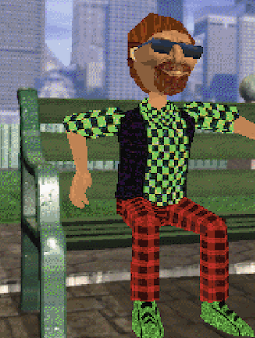
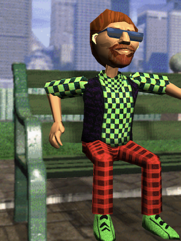

# 3DMM Web

A web-based player and studio for **Microsoft 3D Movie Maker** (`.3mm`) movies,
running entirely in the browser. It parses the original Kauai "chunky" (CHN2)
file format — movies, content libraries, templates, actions, sounds and
bitmaps — and renders scenes with [three.js](https://threejs.org).

No plugins, no emulation: the file-format and scene-playback code is a pure
JavaScript port of the original 1995 engine behavior.

> **Status: early.** This is a work in progress — expect bugs, missing
> editor features and rough edges. Expansion-pack content (e.g. the
> **Nickelodeon Expansion**) can be imported via `?packs=` — see
> [asset packs](#asset-packs). Planned for future releases: built-in support
> for **Frankie's 3DMM Expansion Pack 1**, the **Doraemon Expansion** and
> more TBD.

## Features

- **Movie player** — loads `.3mm` files, plays scenes with backgrounds,
  cameras, actors, actions, transitions, text boxes and sound (MS-ADPCM WAV
  and MIDS MIDI), including pause/scroll/loop semantics from the original.
- **Studio chrome** — recreations of the original editor UI (tool palettes,
  browsers, cursors, sound studio, scene sorter) built from the game's own
  artwork assets.
- **Movie saving** — serializes edited movies back to a valid CHN2 `.3mm`
  file that the original game can open.
- **Modern rendering techniques** — an optional
  [settings menu](#render-settings) layers smooth shading, filtered textures,
  dynamic shadows, high-res rendering and antialiasing on top of the retro
  software-renderer look:

| Original-style rendering | With render settings enabled |
| ------------------------ | ---------------------------- |
|  |  |

## Quick start

The easiest way to try it is the hosted build — no install needed:

**https://permpkin.github.io/3dmm-web/**

Or jump straight into a movie — this loads `hospital.3mm` from the
[3DMMEx](https://github.com/benstone/3DMMEx) samples:

```
https://permpkin.github.io/3dmm-web/?3mm=https://raw.githubusercontent.com/benstone/3DMMEx/main/samples/hospital.3mm
```

### Self-hosting

```sh
npm install
npm run dev        # http://localhost:5173
```

All game data files are bundled in the repo — clone and go.

## Usage

The app is link-driven — which movie is loaded, how it's displayed and where
playback starts all come from the URL, so any state you can reach is
shareable as a link. All parameters combine freely.

### Loading a movie

`?3mm=` picks the movie:

- **A bare filename** like `?3mm=MYMOVIE.3MM` resolves to `movies/MYMOVIE.3MM`
  on the same site — drop your own `.3mm` files in a `movies/` folder next to
  the app to link them by name.
- **A path or full URL** loads a remote `.3mm` file. Relative paths resolve
  against the site; absolute `https://` URLs need the remote host to allow
  CORS — for example the sample movies in the
  [3DMMEx](https://github.com/benstone/3DMMEx) repo:

  ```
  ?3mm=https://raw.githubusercontent.com/benstone/3DMMEx/main/samples/hospital.3mm
  ```

A successful load replaces the autosaved working doc; a failed link falls
back to the normal boot and shows an error. With no `?3mm=`, your working
doc opens as usual (or a blank movie on first run).

### MIDI sound

Music in 3DMM is a MIDI event stream — the original played it through
Windows' GM wavetable synth (`gm.dls`). This port renders the same events
through a real SF2/SF3/DLS sound bank, so the music sounds the way it did
in 1995 — including pitch bends, controllers and the full drum kit.

Drop a bank file into `public/data/` (or `dist/data/` on a deployed build)
and it is picked up automatically, checked in this order:

1. `data/gm.dls` — the authentic choice; `C:\Windows\System32\drivers\gm.dls`
   from any Windows install is the exact bank 3DMM used.
2. `data/soundfont.dls` / `data/soundfont.sf3` / `data/soundfont.sf2` — any
   General MIDI bank (`.sf3` is Vorbis-compressed, so it's smaller).
3. `?sf=<url>` — overrides the list with a bank hosted anywhere.

If no bank is found, music falls back to a small built-in oscillator synth
(it plays the right notes, but not with the right instruments).

### View modes

`mode` chooses how the movie opens, and works with or without `?3mm=` — no
movie param means your working doc is what plays:

- `edit` (default) — the full studio editor: tool palettes, browsers, sound
  studio, scene sorter.
- `theatre` — the original's cinema view: theatre backdrop, lights that dim
  on play, projector-lens play/rewind controls and a wall volume slider.
  Autoplays. (The editor's book button opens the current movie in a theatre
  tab the same way.)
- `embed` — only the letterboxed movie screen with minimal floating
  controls, for iframe embeds. Autoplays.

In theatre and embed modes, `Space` toggles play/pause. `?play` starts
playback immediately in the editor (screen modes already autoplay).

### Recipes

| Link | Opens |
| ---- | ----- |
| `?3mm=https://example.com/movie.3mm` | a remote `.3mm` in the editor |
| `?3mm=https://example.com/movie.3mm&mode=theatre` | the same movie in the theatre |
| `?3mm=MYMOVIE.3MM&mode=embed` | a file from your `movies/` folder, screen only |
| `?mode=theatre` | your working doc in the theatre |
| `?3mm=https://example.com/movie.3mm&scene=2&frame=30` | remote movie at scene index 2 / frame 30 |
| `?3mm=https://example.com/movie.3mm&play&opts=fps24` | remote movie playing with smooth playback |
| `?packs=https://example.com/nick` | editor reskinned by an interface pack |

### Asset packs

`?packs=` takes comma-separated URLs, each pointing to an `assets.json`
manifest (a bare directory URL works too — `assets.json` is appended
automatically). The manifest is an array of file paths relative to the
manifest's URL — the files that make up an expansion pack, e.g.
`expansions/NICK3D/assets.json`:

```json
["TMPLS.3CN", "BKGDS.3CN", "SNDS.3CN", "ACTOR.NTH", "PROP.NTH", "BKGDS.NTH"]
```

What each file does, routed by extension:

- **`.3cn` / `.chk`** — a content library, registered with the engine. Its
  actors, props, backgrounds, materials and sounds become available everywhere,
  including in movies that tag them. `.chk` expansion patches also carry the
  pack's palette: the first 256-entry `GLCR` color list found in the pack
  becomes the palette its thumbnails are drawn with (list it before the
  thumbnail files, as expansions like NICK3D index their own palette — the
  wrong palette is why pack thumbs otherwise show inverted colors).
- **`.3th` / `.nth`** — a thumbnail file; its entries are appended to the
  actor/prop/background browsers and the spletter easels. This is how the
  Nickelodeon expansion's `.NTH` files (ACTOR.NTH, PROP.NTH, …) slot in.
- **`.png` / `.cur`** — UI texture / cursor overrides, matched by filename
  (`button.png` replaces the stock button, and so on).

Packs are additive — builtin content wins on cno collisions. To try the
bundled Nickelodeon expansion locally:

```
http://localhost:5173/?packs=/expansions/NICK3D
```

(`vite.config.js` serves `expansions/` in dev; on a deployed site, host the
pack somewhere CORS-enabled and use its URL instead.)

### Parameter reference

| Param | Description |
| ----- | ----------- |
| `3mm` | Movie to load — bare filename resolves to `movies/<name>` on the site, path or URL for a remote file. |
| `mode` | `edit` (default), `theatre` or `embed` — see [view modes](#view-modes). |
| `scene` | Scene index to open on (e.g. `?scene=2`). |
| `frame` | Frame within the scene (e.g. `?frame=30`). |
| `play` | Start playing immediately (`?play`). |
| `opts` | Comma-separated renderer flags — `fps24`, `modernLighting`, `shadows`, `castOnOthers`, `selfShadow`, `smoothTex`, `smoothVerts`, `scale2x`, `aa`, `wireframe` (e.g. `?opts=fps24,shadows`). See [render settings](#render-settings). |
| `menu` | Open the render settings dialog on boot (`?menu`). |
| `packs` | Comma-separated `assets.json` URLs (or directories containing one) — imports [asset packs](#asset-packs) (e.g. `?packs=/expansions/NICK3D` locally, or a remote URL). |
| `sf` | Sound bank URL for MIDI music (`.sf2`/`.sf3`/`.dls`) — overrides [auto-detection](#midi-sound). |

## Render settings

Click the **settings** link in the studio status bar (bottom edge, next to the
version number) — or the small **settings** button top-left in theatre/embed
modes — to open the render settings dialog. `?menu` opens it automatically on
boot. The dialog is draggable by its title bar (position is remembered);
closing it with `Esc` or canceling reverts everything changed since it was
opened. All settings persist in `localStorage` across sessions, and the
checkbox flags can also be pre-enabled for a link via `?opts=` (the slider and
dropdown values can't — they're not boolean flags).

| Option | Flag | Description |
| ------ | ---- | ----------- |
| smooth playback (24 fps) | `fps24` | Renders interpolated in-between frames instead of stepping at the engine's fixed tick rate |
| modern lighting (smooth shading) | `modernLighting` | Smooth-shaded actor lighting; enables an `intensity` slider (0–200%) |
| shadow opacity | `selfShadowOp` | Darkness slider shared by all shadow effects |
| ground shadows | `shadows` | Shadow-mapped shadows cast onto the ground/background |
| cast on others | `castOnOthers` | Actors cast shadows onto other actors/props (shadow map) |
| self shadows | `selfShadow` | Actors cast shadows onto themselves |
| smooth textures | `smoothTex` | Bilinear texture filtering instead of the original's chunky nearest-pixel look |
| vertex smoothing | `smoothVerts` | Averages vertex normals so actor meshes shade continuously instead of faceted |
| 2x render resolution | `scale2x` | Renders the 640×480 screen at 2× internally, then downscales |
| antialiasing | `aa` | Smooths jagged edges; `mode` dropdown picks `msaa 2x/4x/8x` or `fsaa (2x supersample)` |
| wireframe | `wireframe` | Draws mesh edges only |

## Commands

| Command         | Description                                    |
| --------------- | ---------------------------------------------- |
| `npm run dev`   | Vite dev server                                |
| `npm test`      | `node:test` unit + integration tests (`test/`) |
| `npm run build` | Production build to `dist/`                    |

Tools (run with `node`, files relative to repo root):

```sh
node tools/dump.mjs test/WHERE.3MM [CTG]   # chunky index / chunk listing
node tools/inspect.mjs test/WHERE.3MM      # movie/scene/actor event dump
node tools/play.mjs test/WHERE.3MM         # headless playthrough
node tools/calib.mjs                 # calibration helper
node tools/manifest.mjs              # regenerate public/manifest.json (boot preloader)
```

The boot sequence mirrors the original's `APP::_FInit` (`UTEST.CPP`): the
Microsoft Home logo, then the splash screen with a progress bar while the
content libraries, thumbnails and UI bitmaps load. Afterwards an autosaved
working doc opens straight into the studio (`GetPortfolioDoc`), otherwise a
new (sceneless) movie starts — the original's `FLoadMovie()` blank doc. A
normal reload restores the doc at the last scene+frame viewed; a hard
refresh (Cmd/Ctrl+Shift+R or Shift+F5) wipes the cache first.

## Deployment

The site is a static SPA. `vite.config.js` uses a relative `base`, so the
built `dist/` works under any mount point — including a GitHub Pages
project site at `https://<user>.github.io/<repo>/`.

`.github/workflows/deploy.yml` builds and deploys `dist/` to GitHub Pages on
pushes to `main`, but only when site-affecting files change (`src/`,
`public/`, `index.html`, `vite.config.js`, `package*.json`). To enable it:
**Settings → Pages → Source → GitHub Actions**.

Tests run on every PR and push via `.github/workflows/ci.yml`.

## Project layout

```
src/format/    pure-JS Kauai format ports (chunky, movie, content, kcdc, wav, mids)
src/engine/    scene/actor playback state, content library, sound queue, mat34
src/render/    three.js renderer + canvas textbox layout
src/main.js    app entry: player controls + studio editor chrome
tools/         node CLI helpers for inspecting .3mm/.3cn files
test/          node:test suite (unit + headless MoviePlayer integration)
public/        game data files (content libs, thumbnails, UI art)
```

## Credits & references

This project exists thanks to the people who made, released and preserved
3D Movie Maker:

- **The original 3D Movie Maker team at Microsoft** (1995) — the "Kauai"
  engine and its wonderfully weird file formats. The structure comments in
  `src/` reference their source files (`CHUNK.CPP`, `MOVIE.CPP`,
  `SCENE.CPP`, `CODKAUAI.CPP`, `TXT`, etc.).
- **[microsoft/Microsoft-3D-Movie-Maker](https://github.com/microsoft/Microsoft-3D-Movie-Maker)** —
  Microsoft open-sourced the original code under MIT in May 2022. The format
  and playback code here is a port of that source.
- **[foone/3DMMForever](https://github.com/foone/3DMMForever)** — the
  modernized source release and community hub that keeps 3DMM running on
  modern systems.
- **[benstone/3DMMEx](https://github.com/benstone/3DMMEx)** — a source port
  preserving the classic experience with quality-of-life enhancements.
- **BRender** by Argonaut Software — the renderer used by the original game;
  the `mat34` transform conventions here mirror its 4x3 matrix layout.

## License & legal

Code is ISC (see `package.json`). The 3DMM data files under `public/`
(sounds, textures, cursors, thumbnails, `.3CN` libraries) and the
`test/WHERE.3MM` fixture are **Microsoft copyrighted game assets from
1995**, bundled here for preservation/interoperability purposes only — they
are *not* covered by the code license. Distribute them at your own
discretion; replace them with your own install's files when in doubt.
